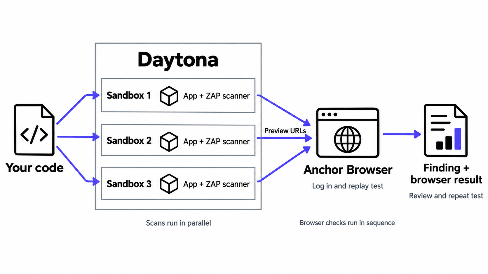
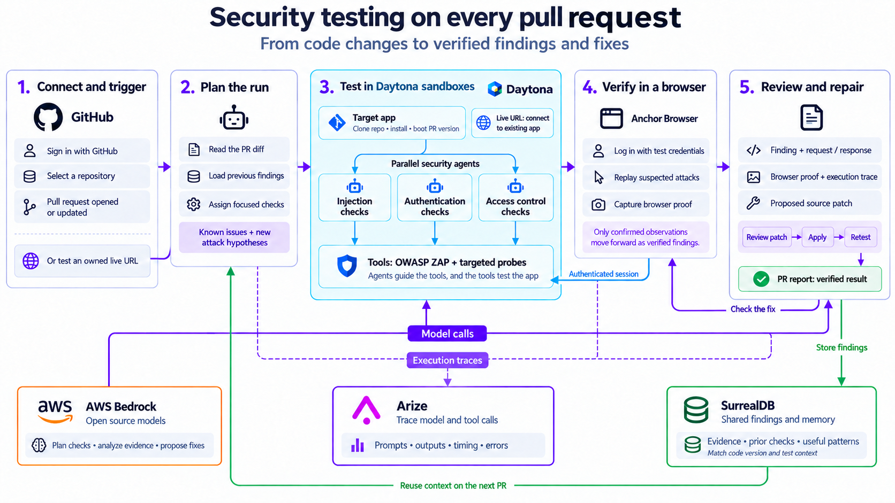

# Pentests

Agentic security testing for small teams. Think Greptile for pentesting.

Pentests runs your app in isolated Daytona sandboxes, scans it with OWASP ZAP, then checks suspected bugs in a browser. AWS Bedrock suggests fixes. After a change, you can run the same browser test again.

## How it works

Each run starts multiple sandboxes, each with an app and scanner. Scans run in parallel. Anchor Browser signs in with a test account and checks each app through its preview URL. Arize receives model and tool traces. SurrealDB stores findings with their app version and test context.



The demo applies a prepared patch before retesting.

The broader design adds pull request triggers and specialist agents:



[Presentation (PDF)](docs/presentation.pdf)

## Run locally

```bash
cd platform
npm ci
cp .env.server.example .env.server
```

Add your Daytona, Anchor Browser, AWS Bedrock, Arize and SurrealDB credentials to `.env.server`. Start the API:

```bash
npm run server
```

In a second terminal:

```bash
cd platform
npm run dev
```

The test app is in [`demo-repo/`](demo-repo/). It includes a login and planted bugs for testing in a sandbox.
